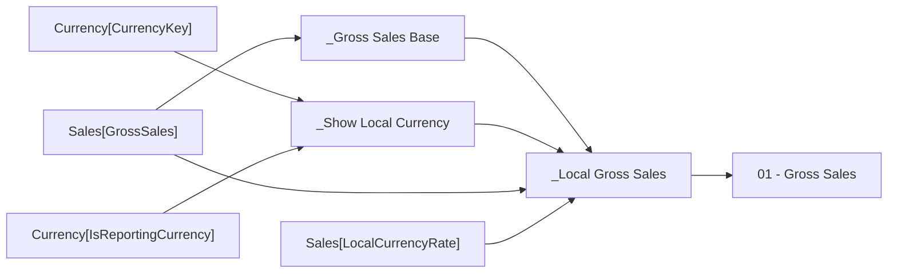

# 01 - Gross Sales

- Home table: `_Measures`
- Display folder: `P&L Actual`
- Hidden: False
- Used by: 03 - Net Sales

Order value at list price after volume pricing, before discounts.

## DAX
```dax
[_Local Gross Sales]
```

## Depends on
- Level 1: [_Local Gross Sales]
- Level 2: [_Gross Sales Base], [_Show Local Currency]

## Source columns
| Model column | Warehouse tables | Source expression |
|---|---|---|
| Currency[CurrencyKey] | dbo.DimCurrency, dbo.FactInternetSales, dbo.FactResellerSales | `CurrencyKey` |
| Currency[IsReportingCurrency] | dbo.DimCurrency, dbo.FactInternetSales, dbo.FactResellerSales | `CAST(CASE WHEN CurrencyAlternateKey = 'USD' THEN 1 ELSE 0 END AS bit)` |
| Sales[GrossSales] | dbo.FactCurrencyRate, dbo.FactInternetSales, dbo.FactResellerSales | `CAST(s.ExtendedAmount AS decimal(19, 4))` |
| Sales[LocalCurrencyRate] | dbo.FactCurrencyRate, dbo.FactInternetSales, dbo.FactResellerSales | `CAST(1.0 / r.AverageRate AS decimal(19, 6))` |

## Lineage
