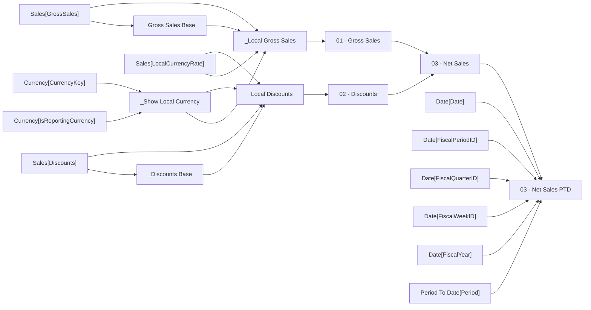

# 03 - Net Sales PTD

- Home table: `_Measures`
- Display folder: `Period To Date`
- Hidden: False
- Used by: no other measure

Net sales to date within the week, period, quarter or year picked in Period To Date.

## DAX
```dax
VAR pick    = SELECTEDVALUE ( 'Period To Date'[Period], "Week" )
VAR lastDay = MAX ( 'Date'[Date] )               -- the end of whatever is selected
VAR wk      = MAX ( 'Date'[FiscalWeekID] )
VAR per     = MAX ( 'Date'[FiscalPeriodID] )
VAR qtr     = MAX ( 'Date'[FiscalQuarterID] )
VAR yr      = MAX ( 'Date'[FiscalYear] )
RETURN
    SWITCH (
        pick,
        "Week",    CALCULATE ( [03 - Net Sales], REMOVEFILTERS ( 'Date' ), 'Date'[FiscalWeekID] = wk ),
        "Period",  CALCULATE ( [03 - Net Sales], REMOVEFILTERS ( 'Date' ), 'Date'[FiscalPeriodID] = per, 'Date'[Date] <= lastDay ),
        "Quarter", CALCULATE ( [03 - Net Sales], REMOVEFILTERS ( 'Date' ), 'Date'[FiscalQuarterID] = qtr, 'Date'[Date] <= lastDay ),
        "Year",    CALCULATE ( [03 - Net Sales], REMOVEFILTERS ( 'Date' ), 'Date'[FiscalYear] = yr, 'Date'[Date] <= lastDay )
    )
```

## Depends on
- Level 1: [03 - Net Sales]
- Level 2: [01 - Gross Sales], [02 - Discounts]
- Level 3: [_Local Discounts], [_Local Gross Sales]
- Level 4: [_Discounts Base], [_Gross Sales Base], [_Show Local Currency]

## Source columns
| Model column | Warehouse tables | Source expression |
|---|---|---|
| Currency[CurrencyKey] | dbo.DimCurrency, dbo.FactInternetSales, dbo.FactResellerSales | `CurrencyKey` |
| Currency[IsReportingCurrency] | dbo.DimCurrency, dbo.FactInternetSales, dbo.FactResellerSales | `CAST(CASE WHEN CurrencyAlternateKey = 'USD' THEN 1 ELSE 0 END AS bit)` |
| Date[Date] | dbo.DimDate | `FullDateAlternateKey` |
| Date[FiscalPeriodID] | dbo.DimDate | `FiscalYear * 100 + FiscalPeriod` |
| Date[FiscalQuarterID] | dbo.DimDate | `FiscalYear * 10 + FiscalQuarter` |
| Date[FiscalWeekID] | dbo.DimDate | `FiscalYear * 100 + FiscalWeek` |
| Date[FiscalYear] | dbo.DimDate | `CASE WHEN days.[Date] > e.YearEnd THEN days.CalendarYear + 1 ELSE days.CalendarYear END` |
| Period To Date[Period] |  | `[Period]` |
| Sales[Discounts] | dbo.FactCurrencyRate, dbo.FactInternetSales, dbo.FactResellerSales | `CAST(s.DiscountAmount AS decimal(19, 4))` |
| Sales[GrossSales] | dbo.FactCurrencyRate, dbo.FactInternetSales, dbo.FactResellerSales | `CAST(s.ExtendedAmount AS decimal(19, 4))` |
| Sales[LocalCurrencyRate] | dbo.FactCurrencyRate, dbo.FactInternetSales, dbo.FactResellerSales | `CAST(1.0 / r.AverageRate AS decimal(19, 6))` |

## Lineage
