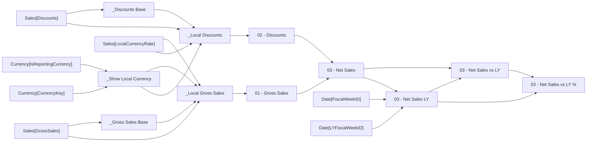

# 03 - Net Sales vs LY %

- Home table: `_Measures`
- Display folder: `Variance`
- Hidden: False
- Used by: no other measure

## DAX
```dax
DIVIDE ( [03 - Net Sales vs LY], [03 - Net Sales LY] )
```

## Depends on
- Level 1: [03 - Net Sales LY], [03 - Net Sales vs LY]
- Level 2: [03 - Net Sales]
- Level 3: [01 - Gross Sales], [02 - Discounts]
- Level 4: [_Local Discounts], [_Local Gross Sales]
- Level 5: [_Discounts Base], [_Gross Sales Base], [_Show Local Currency]

## Source columns
| Model column | Warehouse tables | Source expression |
|---|---|---|
| Currency[CurrencyKey] | dbo.DimCurrency, dbo.FactInternetSales, dbo.FactResellerSales | `CurrencyKey` |
| Currency[IsReportingCurrency] | dbo.DimCurrency, dbo.FactInternetSales, dbo.FactResellerSales | `CAST(CASE WHEN CurrencyAlternateKey = 'USD' THEN 1 ELSE 0 END AS bit)` |
| Date[FiscalWeekID] | dbo.DimDate | `FiscalYear * 100 + FiscalWeek` |
| Date[LYFiscalWeekID] | dbo.DimDate | `ELSE (FiscalYear - 1) * 100 + FiscalWeek END` |
| Sales[Discounts] | dbo.FactCurrencyRate, dbo.FactInternetSales, dbo.FactResellerSales | `CAST(s.DiscountAmount AS decimal(19, 4))` |
| Sales[GrossSales] | dbo.FactCurrencyRate, dbo.FactInternetSales, dbo.FactResellerSales | `CAST(s.ExtendedAmount AS decimal(19, 4))` |
| Sales[LocalCurrencyRate] | dbo.FactCurrencyRate, dbo.FactInternetSales, dbo.FactResellerSales | `CAST(1.0 / r.AverageRate AS decimal(19, 6))` |

## Lineage
