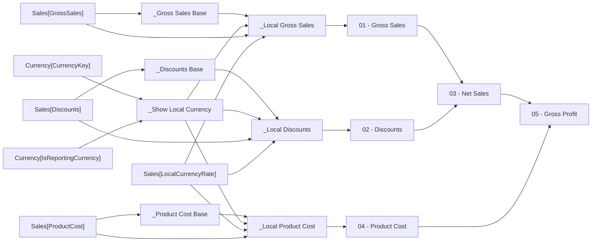

# 05 - Gross Profit

- Home table: `_Measures`
- Display folder: `P&L Actual`
- Hidden: False
- Used by: 05 - Gross Profit LY, Gross Margin %

Net sales less product cost.

## DAX
```dax
[03 - Net Sales] - [04 - Product Cost]
```

## Depends on
- Level 1: [03 - Net Sales], [04 - Product Cost]
- Level 2: [_Local Product Cost], [01 - Gross Sales], [02 - Discounts]
- Level 3: [_Local Discounts], [_Local Gross Sales], [_Product Cost Base], [_Show Local Currency]
- Level 4: [_Discounts Base], [_Gross Sales Base]

## Source columns
| Model column | Warehouse tables | Source expression |
|---|---|---|
| Currency[CurrencyKey] | dbo.DimCurrency, dbo.FactInternetSales, dbo.FactResellerSales | `CurrencyKey` |
| Currency[IsReportingCurrency] | dbo.DimCurrency, dbo.FactInternetSales, dbo.FactResellerSales | `CAST(CASE WHEN CurrencyAlternateKey = 'USD' THEN 1 ELSE 0 END AS bit)` |
| Sales[Discounts] | dbo.FactCurrencyRate, dbo.FactInternetSales, dbo.FactResellerSales | `CAST(s.DiscountAmount AS decimal(19, 4))` |
| Sales[GrossSales] | dbo.FactCurrencyRate, dbo.FactInternetSales, dbo.FactResellerSales | `CAST(s.ExtendedAmount AS decimal(19, 4))` |
| Sales[LocalCurrencyRate] | dbo.FactCurrencyRate, dbo.FactInternetSales, dbo.FactResellerSales | `CAST(1.0 / r.AverageRate AS decimal(19, 6))` |
| Sales[ProductCost] | dbo.FactCurrencyRate, dbo.FactInternetSales, dbo.FactResellerSales | `CAST(s.TotalProductCost AS decimal(19, 4))` |

## Lineage
