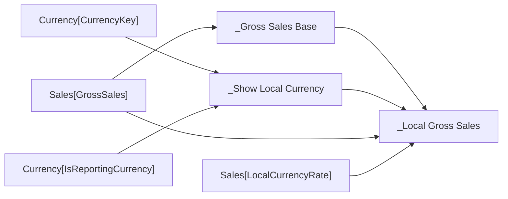

# _Local Gross Sales

- Home table: `_Measures`
- Display folder: `zz Helpers`
- Hidden: True
- Used by: 01 - Gross Sales

## DAX
```dax
IF (
    [_Show Local Currency],
    SUMX ( Sales, Sales[GrossSales] * Sales[LocalCurrencyRate] ),   -- rate differs per row
    [_Gross Sales Base]                                              -- plain SUM, fast
)
```

## Depends on
- Level 1: [_Gross Sales Base], [_Show Local Currency]

## Source columns
| Model column | Warehouse tables | Source expression |
|---|---|---|
| Currency[CurrencyKey] | dbo.DimCurrency, dbo.FactInternetSales, dbo.FactResellerSales | `CurrencyKey` |
| Currency[IsReportingCurrency] | dbo.DimCurrency, dbo.FactInternetSales, dbo.FactResellerSales | `CAST(CASE WHEN CurrencyAlternateKey = 'USD' THEN 1 ELSE 0 END AS bit)` |
| Sales[GrossSales] | dbo.FactCurrencyRate, dbo.FactInternetSales, dbo.FactResellerSales | `CAST(s.ExtendedAmount AS decimal(19, 4))` |
| Sales[LocalCurrencyRate] | dbo.FactCurrencyRate, dbo.FactInternetSales, dbo.FactResellerSales | `CAST(1.0 / r.AverageRate AS decimal(19, 6))` |

## Lineage
