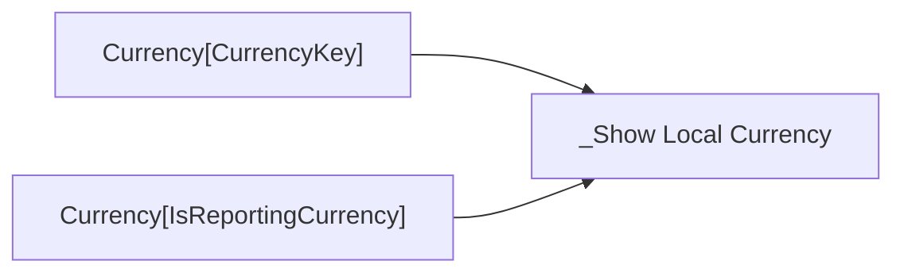

# _Show Local Currency

- Home table: `_Measures`
- Display folder: `zz Helpers`
- Hidden: True
- Used by: _Local Discounts, _Local Gross Sales, _Local Product Cost

True when exactly one currency other than USD is selected.

## DAX
```dax
HASONEVALUE ( 'Currency'[CurrencyKey] )
    && NOT SELECTEDVALUE ( 'Currency'[IsReportingCurrency] )
```

## Depends on
- no other measures

## Source columns
| Model column | Warehouse tables | Source expression |
|---|---|---|
| Currency[CurrencyKey] | dbo.DimCurrency, dbo.FactInternetSales, dbo.FactResellerSales | `CurrencyKey` |
| Currency[IsReportingCurrency] | dbo.DimCurrency, dbo.FactInternetSales, dbo.FactResellerSales | `CAST(CASE WHEN CurrencyAlternateKey = 'USD' THEN 1 ELSE 0 END AS bit)` |

## Lineage
